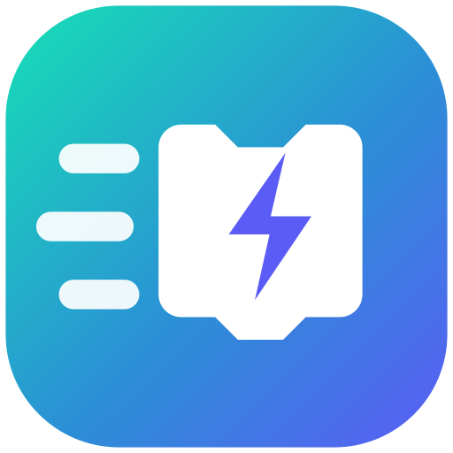

# TurboScratch IDE

A Scratch mod that combines **TurboWarp's** fast compiler, addons and advanced
settings with **real-time collaboration**: several people can edit the same
project at the same time, like in Gandi IDE.

## Online

- Website: **https://turboscratch-ide.github.io**
- Editor: **https://turboscratch-ide.github.io/Turboscratch_IDE/editor.html**

The editor is rebuilt and published automatically by GitHub Actions
(`.github/workflows/deploy-pages.yml`) every time `main` is pushed.

GitHub Pages only hosts the editor's web pages; it can't run the collaboration
server. On the website, type a server address in **Collaborate → Server**:

- `ws://localhost:8090` works for testing with the server running on your own computer.
- To collaborate over the internet, run `collab-server` on a host that supports
  WebSockets and gives you an `https`/`wss://` address. Then set a repository variable
  `TSC_COLLAB_SERVER` (Settings → Secrets and variables → Actions → Variables) to that
  `wss://` address so the website uses it by default. You can set
  `ALLOWED_ORIGINS=https://turboscratch-ide.github.io` on the server to only accept
  connections from the website.

## Start it on your computer

Double-click **`start-turboscratch.command`** (or run it in Terminal). It
starts two things:

| What | Address |
| --- | --- |
| The editor | http://localhost:8601/editor.html |
| The collaboration server | ws://localhost:8090 |

The first start builds the editor, which takes 1–3 minutes. Press `Ctrl+C` in
the window to stop.

## Work together

1. Click **Collaborate** in the menu bar.
2. Type your name and a room code (or click **New code**), then **Join room**.
   - **New room:** your current project becomes the shared project.
   - **Existing room:** your editor switches to the room's project, so save
     your own work first.
3. Click **Copy invite link** and send it to your friends.

Friends on the same Wi-Fi must open the editor using your computer's network
address (the launcher prints it, for example `http://192.168.1.20:8601/editor.html`),
not `localhost`. To work together over the internet, the collaboration server
needs to run somewhere everyone can reach (a VPS or a hosting service with
WebSocket support). Then enter its `wss://` address under **Server** in the
Collaborate dialog.

### What syncs live

- Blocks: adding, moving, deleting, editing numbers/text/dropdowns, custom blocks
- Variables and lists (local and global), comments
- Sprites: add, upload, duplicate, delete (and restore), rename, reorder,
  position/size/direction/visibility
- Costumes and backdrops: add, upload, paint-editor changes, rename, delete,
  duplicate, reorder
- Sounds: add, record/upload, sound-editor changes, rename, delete, duplicate, reorder
- Blocks dragged onto another sprite, extensions, TurboWarp's advanced settings
  (FPS, interpolation, limits, stage size)
- Loading a different project (File → Load / New) replaces the project for everyone
- Presence (who is editing which sprite) and a room chat

Rooms are saved in `collab-server/data/` so they survive a server restart.

### Known limitations

- If two people change the *same* thing at the same moment, the last change wins.
- An open paint or sound editor doesn't redraw when someone else edits that same
  costume/sound; you'll see a notice. Click another costume or sound and back to
  see their change.
- Not synced: monitors (variable displays on the stage), which costume is
  selected, sprite layer order, the project title, turbo mode.
- Anyone who knows a room code can join it. Only share codes with people you trust.
- The "Sprite folders" addon is off by default because it renames and reorders
  things differently on each person's screen, which breaks syncing.
- When something looks out of sync, click **Resync project** in the Collaborate
  dialog to reload the room's copy.

## Folders

| Folder | What's inside |
| --- | --- |
| `editor/` | The editor: TurboWarp's `scratch-gui` plus TurboScratch changes |
| `editor/src/lib/tsc-collab/` | Collaboration engine (session, VM sync, ID-preserving project export) |
| `editor/src/components/tsc-collab/` | Collaborate dialog and menu-bar button |
| `editor/src/lib/themes/accent/turbo.js` | The TurboScratch color theme (default) |
| `collab-server/` | The collaboration server (`npm start`, tests with `npm test`) |
| `branding/` | Logo and app icons |

## Updating from TurboWarp

`editor/` started from TurboWarp/scratch-gui commit
`757231893bb887d9c20379be8937fe97784b3392`. To pull in newer TurboWarp changes,
compare against that commit.

## License and credits

TurboScratch IDE is based on [TurboWarp](https://turbowarp.org/) by Thomas Weber
and contributors, which is based on [Scratch](https://scratch.mit.edu/) by the
Scratch Foundation and MIT. TurboWarp's changes are licensed under GPL-3.0, so
TurboScratch IDE is GPL-3.0 too: if you share it, share the source code as well.
Scratch is a project of the Scratch Foundation; TurboScratch IDE is not affiliated
with or endorsed by the Scratch Foundation or TurboWarp.
